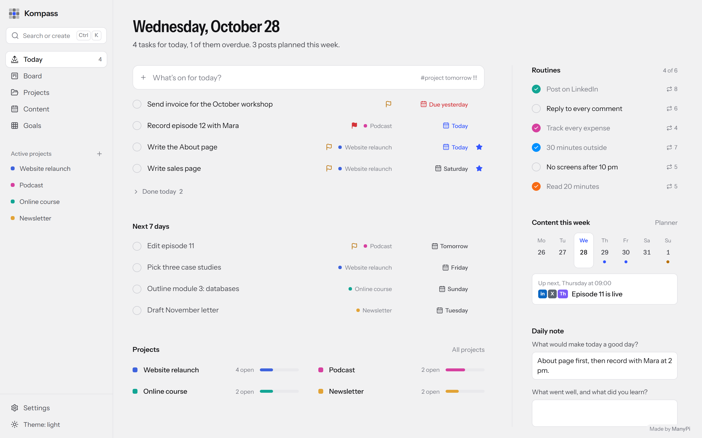
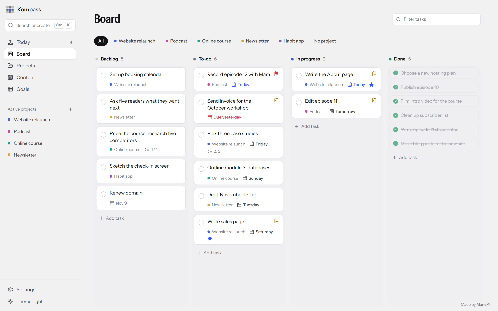
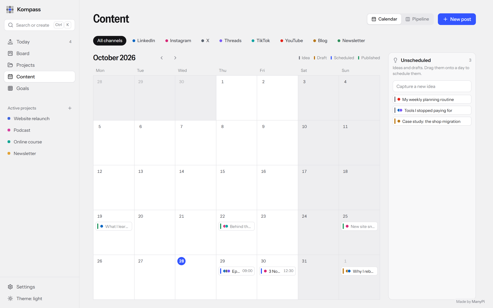
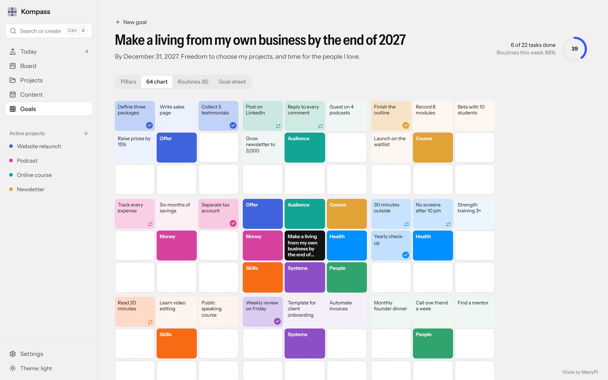
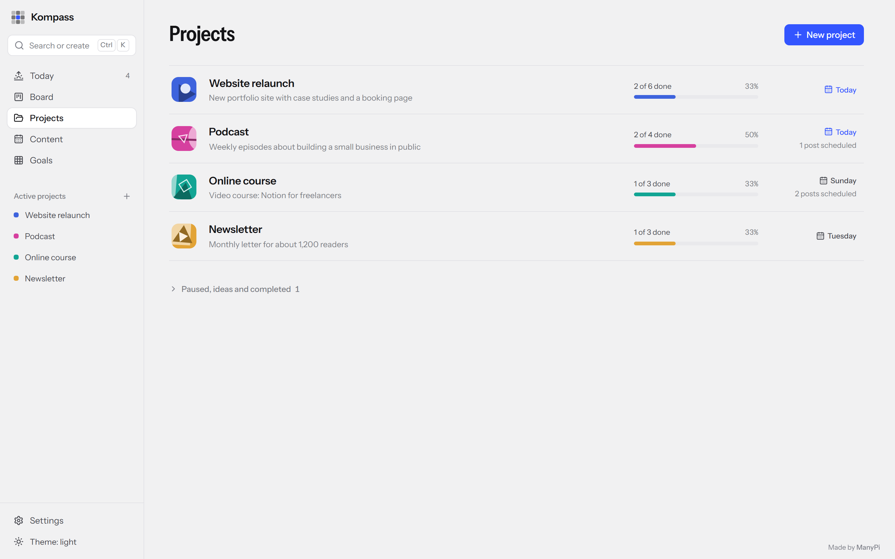
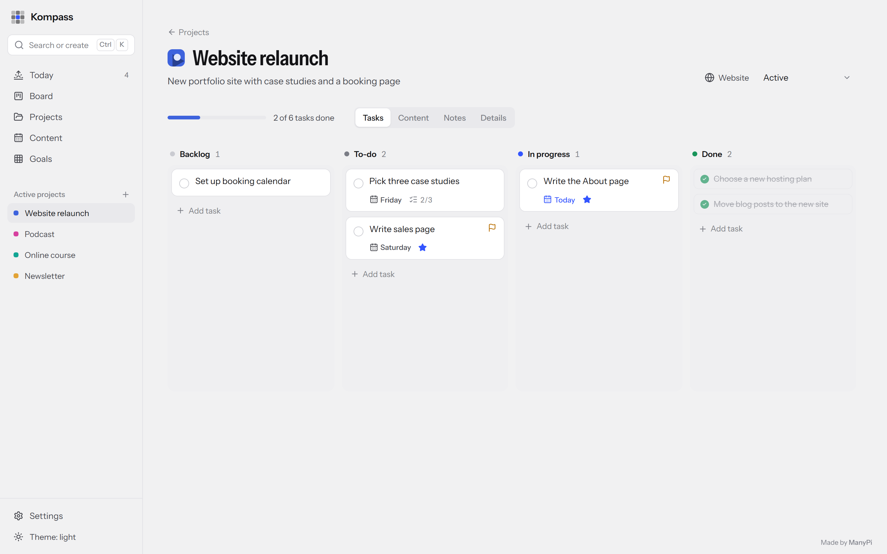
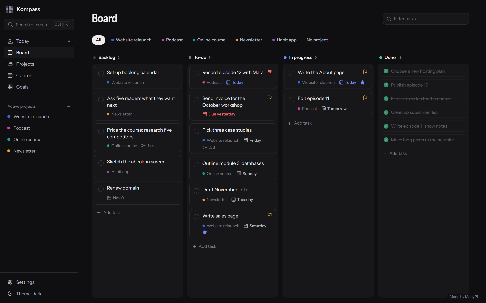

# Kompass

**Ein ruhiger, lokaler Planer für Projekte, Aufgaben, Social-Media-Content und große Ziele.**
Läuft auf deinem eigenen Rechner, funktioniert offline und braucht kein Konto. Auf Deutsch und Englisch.

[English guide → README.md](README.md)



## Was drin ist

| Bereich      | Wofür                                                                                                   |
| ------------ | ------------------------------------------------------------------------------------------------------- |
| **Heute**    | Alles, was heute fällig oder mit Stern markiert ist, deine täglichen Routinen, die Posts der Woche und eine kurze Tagesnotiz |
| **Board**    | Kanban mit Backlog, To-do, In Arbeit und Erledigt, filterbar nach Projekt. Erledigte Aufgaben schrumpfen auf eine Zeile |
| **Projekte** | Fortschritt je Projekt, mit eigenem Board, Content und Notizen                                           |
| **Content**  | Monatskalender mit Drag & Drop, eine Spalte für Ideen ohne Termin und eine Pipeline von der Idee bis zur Veröffentlichung |
| **Ziele**    | Die Harada-Methode: ein großes Ziel, 8 Säulen, 64 Aktionen, tägliche Routinen und ein Ziel-Blatt          |

<table>
  <tr>
    <td></td>
    <td></td>
  </tr>
  <tr>
    <td></td>
    <td></td>
  </tr>
  <tr>
    <td></td>
    <td></td>
  </tr>
</table>

<sub>Die Screenshots zeigen ausgedachte Beispieldaten. Eine frische Installation startet leer.</sub>

## Installieren

Kompass läuft unter **Windows 10/11, macOS und Linux**. Die Einrichtung dauert etwa zwei Minuten.

### 1. Node.js installieren

Kompass läuft mit Node.js. Installiere es zuerst, falls du es noch nicht hast:
Auf [nodejs.org](https://nodejs.org) die **LTS**-Version herunterladen und den Installer mit den Standardeinstellungen durchklicken.
Kompass braucht Node.js 22.13 oder neuer.

### 2. Kompass herunterladen

Öffne das [neueste Release](../../releases/latest) und lade `kompass-….zip` herunter. Entpacke die Datei an einem beliebigen Ort, zum Beispiel im Download-Ordner.

<sub>Noch kein Release da? Dann über den grünen Button **Code** → **Download ZIP**. Das Installationsprogramm baut Kompass dann selbst. Dafür braucht es eine Internetverbindung, und es dauert etwa eine Minute länger.</sub>

### 3. Installationsprogramm starten

**Windows:** Doppelklick auf **`install.cmd`** im entpackten Ordner.
Falls Windows fragt, ob die Datei ausgeführt werden soll, wähle **Ausführen** (bzw. **Weitere Informationen → Trotzdem ausführen**). Ein Fenster zeigt den Fortschritt. Sobald dort *Fertig* steht, öffnet sich Kompass. Danach startest du es über das **Kompass**-Symbol auf dem Desktop oder im Startmenü.

**macOS:** Öffne das **Terminal** (⌘ Leertaste drücken, *Terminal* tippen, Return). Tippe `bash ` mit einem Leerzeichen am Ende, zieh die Datei **`install.sh`** aus dem entpackten Ordner ins Terminal-Fenster und drück Return.
Kompass öffnet sich, sobald alles fertig ist. Später findest du es im Ordner **Programme** in deinem Benutzerordner oder über Spotlight.

**Linux:** Öffne ein Terminal im entpackten Ordner und führe `bash install.sh` aus.
Kompass erscheint dann im App-Menü, und du kannst es auch mit dem Befehl `kompass` starten.

Den heruntergeladenen Ordner kannst du danach löschen; Kompass wurde an einen eigenen Ort kopiert.

Kompass öffnet sich in einem eigenen Fenster, wenn Chrome, Edge, Brave oder Chromium installiert ist. Sonst öffnet es sich als Tab im Standardbrowser, was genauso gut funktioniert.
Schließt du das letzte Kompass-Fenster, beendet sich Kompass ein paar Sekunden später vollständig.

## Erste Schritte

1. **Projekte → Neues Projekt.** Gib ihm einen Namen und eine Farbe; das Icon wird automatisch erzeugt.
2. **Aufgaben anlegen**: auf dem Board oder überall mit **N** für die Schnelleingabe.
3. Markiere mit dem **Stern**, was heute zählt. Es erscheint dann unter **Heute**.
4. Plane Posts unter **Content**: Ideen aus *Ohne Termin* auf einen Tag ziehen.
5. Lege unter **Ziele** ein großes Ziel an. Fang mit etwa zehn Aktionen an. Wiederkehrende machst du zu **Routinen** und hakst sie täglich auf der Heute-Seite ab.

### Schnelleingabe

Drück **N** (oder **Strg K** / **⌘ K**) und tippe zum Beispiel:

```
Landingpage fixen #website morgen !!! *
```

| Du tippst                                                     | Kompass versteht                                   |
| ------------------------------------------------------------- | -------------------------------------------------- |
| `#website`                                                    | Projekt (der Anfang des Namens reicht)             |
| `heute`, `morgen`, `übermorgen`, `freitag`, `nächste woche`   | Fälligkeit (englische Wörter wie `tomorrow` gehen auch) |
| `24.12.` oder `2026-12-24`                                    | Fälligkeit                                         |
| `!` `!!` `!!!` oder `!niedrig` `!mittel` `!hoch`               | Priorität                                          |
| `*`                                                           | In den Fokus für heute                             |

### Tastenkürzel

| Tasten                | Aktion                                  |
| --------------------- | --------------------------------------- |
| **Strg K** / **⌘ K**  | Suchen oder erstellen                   |
| **N**                 | Schnelleingabe                          |
| **1** – **5**         | Heute, Board, Projekte, Content, Ziele  |
| **Esc**               | Panel oder Dialog schließen             |

### Sprache und Design

Kompass folgt deiner Systemsprache (Deutsch oder Englisch; Englisch für alle anderen Sprachen) und deiner Hell-/Dunkel-Einstellung.
Beides kannst du unter **Einstellungen** ändern.

## Deine Daten

Alles bleibt auf deinem Rechner, in einer einzigen SQLite-Datei. Es gibt kein Konto, keine Cloud und kein Tracking. Kompass nimmt nur Verbindungen von deinem eigenen Rechner an.

| System  | Datenordner                                  |
| ------- | -------------------------------------------- |
| Windows | `%APPDATA%\Kompass`                          |
| macOS   | `~/Library/Application Support/Kompass`      |
| Linux   | `~/.local/share/kompass`                     |

- Beim ersten Start jedes Tages wird automatisch eine **Sicherung** angelegt; die letzten 14 liegen im Ordner `backups`.
- **Einstellungen → Exportieren** speichert alles als JSON-Datei. **Einstellungen → Import** stellt so eine Datei wieder her (ersetzt die aktuellen Daten, nachdem eine Sicherung angelegt wurde).
- **Einstellungen → Ordner öffnen** zeigt den Datenordner.

**Erst mal umschauen?** Führe im heruntergeladenen Ordner `node scripts/sample-data.mjs` aus. Importiere dann die erzeugte Datei `kompass-sample-data.json` unter **Einstellungen → Import**. Die Beispieldaten sind auf Englisch und ersetzen deine Daten, also mach das, bevor du richtig loslegst. Hast du schon Daten, exportiere sie vorher.

## Aktualisieren

Neue Version herunterladen und das Installationsprogramm noch einmal starten wie in Schritt 3. Deine Daten bleiben, wo sie sind.

## Deinstallieren

- **Windows:** Doppelklick auf `uninstall.cmd` im heruntergeladenen Ordner.
- **macOS und Linux:** `bash install.sh --uninstall` ausführen. Unter macOS kannst du **Kompass** auch einfach aus dem Programme-Ordner in den Papierkorb ziehen.

Dein Datenordner (siehe oben) bleibt erhalten. Lösche ihn auch, wenn du alles entfernen willst.

## Wenn etwas nicht klappt

- **„Node.js wurde nicht gefunden“**, obwohl es installiert ist: Starte den Rechner einmal neu, damit das neue Programm gefunden wird, und versuch es dann noch einmal.
- **Kompass startet nicht:** Schau in die Datei `server.log` im Datenordner. Eventuell belegt schon ein anderes Programm den Port 4747.
- **Kompass öffnet sich als Browser-Tab statt in einem eigenen Fenster:** Es wurde kein Chrome, Edge, Brave oder Chromium gefunden. Alles funktioniert trotzdem genauso; installiere einen davon, wenn du lieber ein eigenes Fenster hast.

## Für Entwickler

Siehe den Abschnitt [For developers](README.md#for-developers) in der englischen Anleitung.

## Lizenz

[MIT](LICENSE) · Gemacht von [ManyPi](https://manypi.com)
